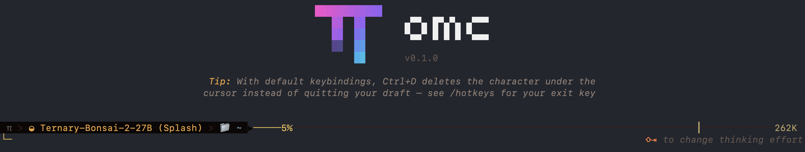

# omc (oh-my-c)

A from-scratch C rewrite of [oh-my-pi (omp)](https://github.com/can1357/oh-my-pi), the coding agent. It doesn't use Node, Bun or npm , all it needs at runtime is the system's libc, OpenSSL (for TLS), zlib (for gzip), pthreads and libm.

```
$ ldd build/omc
    libssl.so.3  libcrypto.so.3  libz.so.1  libm.so.6  libc.so.6
```
Current equivalent OMP release: v19.1.0

## Why

Having Oh-My-Pi fully rewritten in C lets me easily embed it in any project I want. Since it can also be built as `libomc`, you can use it inside existing software written in C/C++, inject it into any game to assist modding, use it as RE tooling for instrumentation, create more integrated assistants and use it in embedded systems.

It also solved another problem for me: I don't have to install Bun or any other Node.js-related library on my host. A lot of supply-chain attacks have happened lately, so I prefer to stay in my comfy C/C++ world.

## Installing

omc's version is the omp release it matches, so `omc v19.1.0` behaves like `omp v19.1.0`.

The quick way picks the right binary for your system, checks it against `SHA256SUMS` and installs it into `~/.local/bin`:

```sh
curl -fsSL https://raw.githubusercontent.com/buzzer-re/Oh-My-C/main/install.sh | sh
```

If you prefer to build it on your own machine, pass `--build`. It downloads the release's source instead and compiles it, so you need the same things as in [Building](#building) below:

```sh
curl -fsSL https://raw.githubusercontent.com/buzzer-re/Oh-My-C/main/install.sh | sh -s -- --build
./install.sh --build                # the same, from a clone
```

On Windows 10/11 (x64), paste this into PowerShell. It installs the release's `omc.exe` the same way, checked against `SHA256SUMS`, into `%LOCALAPPDATA%\Programs\omc`, and offers to add it to your PATH. omc's bash tool runs Git for Windows' bash when it's installed, PowerShell otherwise. See [docs/windows.md](docs/windows.md).

```powershell
irm https://raw.githubusercontent.com/buzzer-re/Oh-My-C/main/install.ps1 | iex
```

To pass options, run it as a script block: `-Lib` also installs `libomc.dll`, and `-Build` compiles it from source (it needs MinGW-w64 in WSL or MSYS2):

```powershell
& ([scriptblock]::Create((irm https://raw.githubusercontent.com/buzzer-re/Oh-My-C/main/install.ps1))) -Lib
.\install.ps1 -Build -Source .      # from a clone
```

### Updating

`omc update` installs the latest release's binary over the one you run, checked against `SHA256SUMS` like the installer does; `omc update --check` only tells you whether there is a newer one. Interactive sessions also check on startup and show a notice when a release is out (turn it off with `startup.checkUpdate: false`, or set `update.auto: true` to install it in the background). A build from a clone updates with `git pull && make` instead.


## Building

You just need a C11 compiler, make, and the OpenSSL 3 and zlib headers (on Debian/Ubuntu: `build-essential libssl-dev zlib1g-dev`, on Fedora: `gcc make openssl-devel zlib-devel`, on macOS: the Xcode command line tools and Homebrew's `openssl@3`).

```sh
make            # -> build/omc
make test       # unit tests + end-to-end tests against a local mock model server
make install    # -> ~/.local/bin/omc  (system-wide: sudo make install PREFIX=/usr/local)
```

## Using

You can use it the same way you already use `omp`. Just run `omc` and you will get the same UI and features, but without Node or Bun.


```sh
omc                                 # interactive TUI
omc "fix the failing test"          # interactive with an initial prompt
omc -p "summarize src/"             # print mode
omc --mode json -p "..."            # JSON event stream
omc --mode rpc                      # JSONL RPC over stdin/stdout (omp protocol)
omc -c                              # continue the last session;  -r <id> resumes one, -r alone picks
omc --model=opus @shot.png "why?"   # pick a model; @file / @image arguments join the first prompt
omc login anthropic                 # OAuth (Claude Pro/Max, ChatGPT/Codex, ...)
omc models opus                     # list available models (also: models find <text>, --json)
omc read src/main.c                 # what the read tool returns (also: grep, search)
omc --help                          # every flag and command (omc <command> --help for one)
```

Your configuration lives in `~/.omc/agent/` (`config.yml`, `models.yml`, `auth.json`, `mcp.json`,
`lsp.json`, `AGENTS.md`, `RULES.md`, `skills/`, `rules/`, `agents/`). Projects can use either `.omc/`
or omp's `.omp/` directory. omc also reads `AGENTS.md`, `CLAUDE.md` and the context files of other
tools, but it doesn't read everything that omp does yet. Sessions are saved as omp-compatible JSONL
under `~/.omc/agent/sessions/`.

If you want to migrate your `omp` setup, just run `/migrate` inside `omc` and it will copy your existing configuration.

## Embedding

The library is an optional build, so you only get it if you ask for it.

```sh
make lib            # -> build/libomc.a, build/libomc.so.0, build/omc.pc  (public API: include/omc.h)
make install-lib    # -> ~/.local/{include,lib}  (system-wide: sudo make install-lib PREFIX=/usr/local)
cc app.c $(pkg-config --cflags --libs omc)        # or: -Iinclude build/libomc.a -lssl -lcrypto -lz -lpthread -lm
```

The library only exports the `omc_*` API, and the static archive is prelinked so its internal names
never clash with your app. A session speaks the same JSON protocol as `omc --mode rpc`: you send
commands with `omc_send()` and receive the responses and agent events through one callback.
`omc_prompt()` runs a turn synchronously, `omc_register_tool()` adds native tools implemented by your
app, and `omc_main()` runs the whole CLI/TUI in-process. You can check `examples/embed.c` for an example.

On Windows, `make WINDOWS=1 lib` (or `install.ps1 -Lib`) gives `libomc.dll` with its import library, a static
`libomc.a`, a `.def` for MSVC and `omc.h`; link with `-lomc`. See [docs/windows.md](docs/windows.md#libomc-on-windows).

## Documentation

All the architecture and design docs are in [docs/](docs/index.md). There you can find how omc is
layered and how each module maps to omp ([architecture](docs/architecture.md)), the
[build and embedded assets](docs/build.md), the [provider layer](docs/ai.md), the
[agent runtime](docs/agent.md), the [tools](docs/tools.md), the [terminal UI](docs/tui.md), the
[run modes and library API](docs/modes.md), [testing](docs/testing.md) and
[security](docs/security.md). The same files are embedded in the binary, so the model can read them
as `omc://`.

Check [docs/status.md](docs/status.md) to see what is and isn't implemented yet, and
[docs/CONVENTIONS.md](docs/CONVENTIONS.md) for the coding rules.

## Credits

Of course, all the credit goes to the [OMP](https://github.com/can1357/oh-my-pi) team. This tool was not created to compete with or replace it. It was created for a specific scenario that I face daily and wanted to solve. You can use it as is, but don't expect development on this "fork" to be as fast as on the original project.
